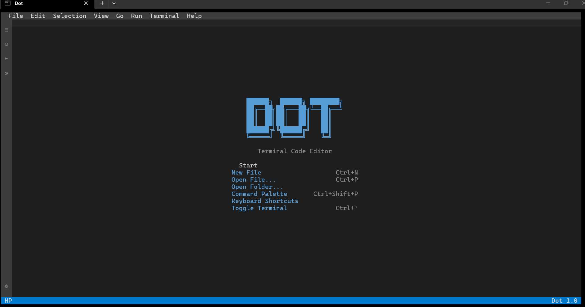
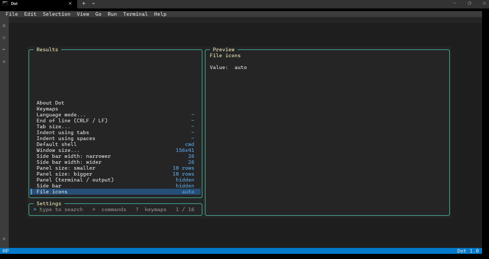
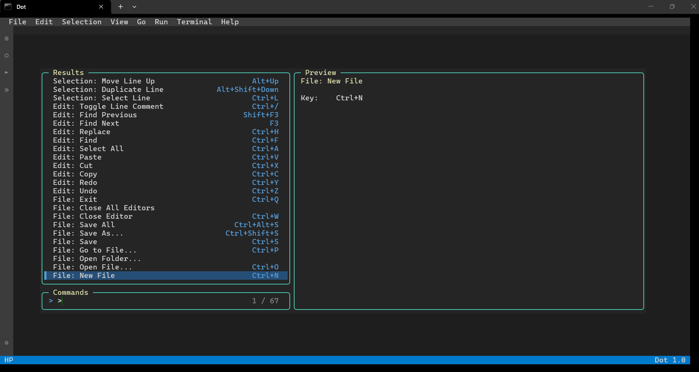

<div align="center">

<pre>
██████╗  ██████╗ ████████╗
██╔══██╗██╔═══██╗╚══██╔══╝
██║  ██║██║   ██║   ██║   
██║  ██║██║   ██║   ██║   
██████╔╝╚██████╔╝   ██║   
╚═════╝  ╚═════╝    ╚═╝   
</pre>

</div>

<p align="center">
  <b>dot</b>  a VS Code style code editor that runs in your <b>terminal</b>
</p>

<p align="center">
  <a href="#run-it"></a>
  <a href="#architecture"></a>
  <a href="#run-it"></a>
  <a href="#file-icons"></a>
</p>


> **⚠️ Honest framing.** Dot is a small, fast, single file terminal editor, not a replacement for VS Code. It has no plugins, no debugger, no language server and no git UI. The Windows builds are cross compiled; it is developed and tested on Linux in a pseudo terminal, so please report anything odd on your Windows version.


## Table of contents

1. [Run it](#run-it)
2. [Using Dot](#using-dot)
3. [LazyVim-style menus](#lazyvim-style-menus)
4. [Terminal panel](#terminal-panel)
5. [Image viewer](#image-viewer)
6. [Themes](#themes)
7. [Keyboard shortcuts](#keyboard-shortcuts)
8. [File icons](#file-icons)
9. [Colours and old Windows](#colours-and-old-windows)
10. [Windows XP](#windows-xp)
11. [Architecture](#architecture)
12. [Building](#building)
13. [Extending](#extending)
14. [Troubleshooting](#troubleshooting)
15. [Credits](#credits)


## Run it

You need **Go 1.20.x**: the last Go version whose programs still run on Windows 7/8. On Windows 10/11 any newer Go also works, but the `.exe` will then need Windows 10+.

```bat
:: 1. check Go
go version

:: 2. go to the project folder (the one with go.mod)
cd Dot

:: 3a. run straight from source
go run .

:: 3b. ...or open a folder / file
go run . C:\Projects\my-app
go run . main.go

:: 4. build an exe and start it
go build -o dot.exe .
dot.exe
```

Run it in a real console (**cmd**, **PowerShell** or **Windows Terminal**), not inside another editor's output pane. Quit with **Ctrl+Q**.

### Install so that `.dot` works everywhere

```bat
scripts\build.bat        :: builds dot.exe + bin64\dot.exe + bin32\dot.exe
scripts\install.bat      :: copies Dot to %LOCALAPPDATA%\Dot, adds it to PATH, installs the icon font
```

Open a **new** terminal and type:

```bat
.dot                 :: open the current folder
.dot file.py         :: open a file
.dot C:\Projects\x   :: open a folder
```

| Setup | Result |
| --- | --- |
| Windows 10 1703+ / Windows Terminal | True-colour VS Code Dark+ |
| Windows 7 / 8 | Classic console API with a redefined 16-colour palette |
| Windows XP | Classic console API, the console's default 16 colours (`binxp\dot.exe`, see [Windows XP](#windows-xp)) |
| Icon font not installed | Coloured squares instead of file icons |


## Using Dot

### 1. Initial Look :


### 2. Settings Tab :


### 3. Command Palette :


<br/>

| Key | What it does |
| --- | --- |
| **Ctrl+N / Ctrl+S / Ctrl+W** | New file / save / close tab |
| **Ctrl+Z / Ctrl+Y** | Undo / redo |
| **Ctrl+C / X / V** | Copy / cut / paste (Windows clipboard) |
| **Ctrl+F / Ctrl+H** | Find / replace (case, whole word, regex) |
| **Ctrl+Shift+F** | Search in files |
| **Ctrl+G** | Go to line |
| **Ctrl+/** | Toggle line comment |
| **Alt+↑ / Alt+↓** | Move line |
| **Ctrl+Shift+K** | Delete line |
| **Tab / Shift+Tab** | Indent / outdent |
| **Ctrl+B / Ctrl+J** | Toggle side bar / panel |
| **Ctrl+PgUp / PgDn** | Switch tab |
| **F5 / Shift+F5** | Run current file / stop |
| **Ctrl+,** | Settings |
| **Ctrl+K** | Keyboard shortcuts (view and change) |
| **Ctrl+Alt+T** | Color theme |
| **Ctrl+Q** | Quit |

**Things to try**

- Press **Ctrl+P**, type part of a file name: live preview on the right
- Press **F5** on a `.py` / `.js` / `.go` / `.bat` file: output appears in the panel, and anything you type goes to the program
- Drag the panel header with the mouse to resize it
- Click the menu bar (File, Edit, …) or right-click in the editor or explorer
- Open a `.png` / `.jpg` / `.gif` from the explorer: it shows as a picture
- Press **Ctrl+Alt+T** to change the colour theme, **Ctrl+K** to change shortcuts

Syntax colours: Go, Python, JavaScript, TypeScript, C, C++, C#, Java, Rust, Lua, Ruby, PHP, Shell, Batch, PowerShell, SQL, HTML, XML, CSS, JSON, YAML, INI/TOML, Markdown, VBScript, Makefile.


## LazyVim-style menus

| Key | Opens |
| --- | --- |
| **Ctrl+P** | Telescope-style finder: results above, prompt below, file preview on the right |
| **Ctrl+P**, then `>` | Commands |
| **Ctrl+P**, then `?` | Searchable list of every key binding |
| **Ctrl+P**, then `:` | Go to line |
| **Ctrl+Shift+P / F1 / Ctrl+Space / F4** | **Which-key** leader menu |

In the which-key menu press the letters shown:

| Keys | Action |
| --- | --- |
| `SPC` | Find file |
| `/` | Search in files |
| `e` | Explorer |
| `p` | Command palette |
| `,` | Settings |
| `` ` `` | Terminal |
| `r` | Run file |
| `f` `s` | **f**ile → **s**ave |
| `s` `g` | **s**earch → **g**rep |
| `b` `d` | **b**uffer → close |
| `u` `m` | **u**i → **m**aximize panel |
| `u` `c` | **u**i → **c**olor theme |
| `u` `v` | **u**i → image **v**iewer |
| `h` `s` | **h**elp → keyboard **s**hortcuts (edit) |
| `q` `q` | Quit |

`Backspace` goes back one level, `Esc` closes.


## Terminal panel

`` Ctrl+` `` toggles it. **OUTPUT** shows the result of **F5**, **TERMINAL** runs commands (`cmd` or PowerShell on Windows; `cd`, `cls` and `exit` are built in).

| Action | How |
| --- | --- |
| Resize | Drag the OUTPUT / TERMINAL header bar |
| Maximize / restore | Double-click the header, or **Ctrl+Shift+M** |
| Bigger / smaller | **Ctrl+Alt+↑ / Ctrl+Alt+↓** |
| Side bar width | Drag its right edge |
| Stop a running program | **Ctrl+C** (in the panel) or **Shift+F5** |
| Back to the editor | **Esc** |

Programs run with piped input and output, not a real TTY: interactive full-screen programs (REPLs, `vim`, …) will not work, but scripts that read lines from stdin do.

Run commands per file type (the language must be installed on the machine):

| Extension | Command |
| --- | --- |
| `.py` | `python` / `py` |
| `.js` | `node` |
| `.go` | `go run` |
| `.bat` `.cmd` | `cmd` |
| `.ps1` | `powershell` |
| `.lua` `.rb` `.php` `.vbs` | `lua` / `ruby` / `php` / `cscript` |
| `.java` | `java` |
| `.c` `.cpp` | `gcc` / `g++`, then run |
| `.html` | opens in the browser |


## Image viewer

Open a **PNG, JPEG or GIF** (first frame) from the explorer, **Ctrl+P**, or the command line (`.dot photo.png`) and it opens full screen. Each character cell shows two pixels, so a normal terminal can display real pictures.

| Key | Action |
| --- | --- |
| `+` / `-` or mouse wheel | Zoom in / out |
| Arrow keys (or `h j k l`) | Pan when zoomed |
| `f` | Fit to window |
| `1` | Actual size (1 image pixel = 1 screen pixel) |
| `n` / `p` (or Space / Backspace) | Next / previous image in the same folder |
| `o` | Open the file as text instead |
| `Esc` or `q` | Close |

Also: **View → Image Viewer…**, or **Ctrl+Shift+P** → `u` `v`. Windows Terminal / Windows 10 show full 24-bit colour. Windows 7 / 8 / XP consoles only have 16 colours, so Dot switches them to the standard VGA palette while the viewer is open and dithers the picture (it looks coarse, but works). WebP / BMP / SVG are not supported.


## Themes

**Settings → Color theme…**, **Ctrl+Alt+T**, **Ctrl+Shift+P** → `u` `c`, or **View → Color Theme…**. Built in: Dark+ (default), Light+, Monokai, Solarized Dark, Dracula, One Dark, Nord, Gruvbox Dark, High Contrast. The choice is saved (`theme=` in `settings.ini`) and also works on old consoles (the 16 console colours are redefined). To add one, append a `Theme{...}` line to `src/theme.go`.


## Keyboard shortcuts

Press **Ctrl+K** (or **Settings → Keyboard shortcuts…**, **Help → Keyboard Shortcuts**, **Ctrl+Shift+P** → `h` `s`) to see every command with its keys.

1. Type to search for a command, press **Enter** on it.
2. Press the new key combination (needs **Ctrl+…**, **Alt+…** or an **F key**).
3. **Backspace** removes the command's shortcuts, **Esc** cancels. *Reset ALL shortcuts to default* is the first line of the list.

A key that was used by another command moves to the new one. Changes are saved in `settings.ini` as `key.ctrl+t=view.sidebar` (`key.ctrl+s=none` removes a default key), so you can also edit them by hand. If you ever lock yourself out, delete the `key.` lines.


## File icons

A terminal can only draw text, so the real [vscode-icons](https://github.com/vscode-icons/vscode-icons) SVGs are packed into a **colour font** (`assets/font/DotIcons.ttf`, ~1,240 icons) by `tools/gen_icons.py`.

**If the font is not installed and selected, you only see squares**, so two things must be done once:

1. **Install the font**: double-click `assets\font\DotIcons.ttf` → **Install** (or right-click → **Install for all users**). `scripts\install.bat` also tries to do this for you.
2. In **Windows Terminal** → *Settings → Profiles → Defaults → Appearance* set **Font face** to:

```
Cascadia Mono, DotIcons
```

3. **Fully close and reopen** the terminal, run `.dot`.
4. In Dot press **Ctrl+,** → **File icons** until it says **on** (auto only turns on when Dot finds the font file in `%LOCALAPPDATA%\Microsoft\Windows\Fonts` or `C:\Windows\Fonts`).

The choice is **saved** in `%APPDATA%\Dot\settings.ini`, so it stays after a restart. Windows 7 / 8 / XP consoles cannot show icon fonts: Dot turns icons off there and Settings says so.

Can't find the font file, or Install is missing? Run `scripts\install.bat`, or put `DotIcons.ttf` in `%LOCALAPPDATA%\Microsoft\Windows\Fonts`.

### Settings file

`%APPDATA%\Dot\settings.ini` (Linux: `~/.config/dot/settings.ini`) is plain text and can be edited by hand:

```ini
icons=on # auto | on | off
theme=Dracula
sidebar=1
panel=0
side_width=26
panel_height=10
shell=cmd

# changed shortcuts (key.<keys>=<command id> | none)
key.ctrl+t=view.sidebar

# give your own extensions an existing icon (any extension from the set)
alias.mjs=js
alias.tsx=ts
alias.vue=html
```

### Adding your own icons

*Use an icon that already exists for a new extension*: the `alias.` lines above, no rebuild needed.

*Add a brand-new icon picture*:

1. `git clone --depth 1 https://github.com/vscode-icons/vscode-icons`
2. Put your SVG into `vscode-icons/icons/` as `file_type_<name>.svg` (a simple 16x16 / 32x32 SVG with solid colours works best; gradients are reduced to their first colour).
3. Map an extension to it in `vscode-icons/src/iconsManifest/supportedExtensions.ts` (an entry like `{ icon: 'myfmt', extensions: ['myf'], format: FileFormat.svg }`).
4. Regenerate the font (below), copy `out/icons_data.go` over `src/icons_data.go`, rebuild with `scripts\build.bat`, **uninstall and re-install** the new `DotIcons.ttf`, restart the terminal.

Settings → *File icons* cycles **auto / on / off**.

Regenerate the font (needs Python and `pip install fonttools`):

```bash
git clone --depth 1 https://github.com/vscode-icons/vscode-icons
python tools/gen_icons.py vscode-icons out
python tools/fix_names.py out/DotIcons.ttf
# writes out/DotIcons.ttf and out/icons_data.go (copy icons_data.go over src/icons_data.go)
```


## Colours and old Windows

- **Windows 10 1703+ / Windows Terminal** → ANSI true-colour (VS Code Dark+ exact).
- **Windows 7 / 8** → the classic console API (`WriteConsoleOutputW`) with a redefined 16-colour palette, so the same colours appear without ANSI support.
- Force a mode: `.dot --vt` or `.dot --legacy`.
- Window too small? **Ctrl+Shift+P** → `u` `w` for size presets (classic console only).
- Themes work in both modes (**Ctrl+Alt+T**).


## Windows XP

XP is supported through a separate build made with **Go 1.10.8**, the last Go release that still runs on XP (newer Go needs Windows 7 or later). The code is kept compatible with both, so it is the same source.

```bat
:: 1. unzip https://go.dev/dl/go1.10.8.windows-386.zip, put its bin folder first in PATH
go version :: must say go1.10.8
scripts\build_xp.bat :: -> binxp\dot.exe (32-bit)
scripts\install_xp.bat :: -> %USERPROFILE%\Dot, adds it to PATH (log off/on once)
```

On XP: no true colour (the console's default 16 colours are used), no icon font, `taskkill` and PowerShell may be missing so the panel uses `cmd` only. Python, Node, etc. must exist on the machine for F5 to run them. `binxp\dot.exe` also runs on every newer Windows.


## Architecture

No third-party Go modules: only the standard library and raw Win32 calls.

| File | Role |
| --- | --- |
| `main.go` | Entry point (calls `src.Run`) |
| `src/run.go` | Arguments, start-up, main loop |
| `src/screen.go` | Palette, screen buffer, ANSI renderer |
| `src/term_windows.go` | Win32 console: output, keyboard, mouse, clipboard |
| `src/term_linux.go` / `src/term_other.go` | Linux backend (used for testing) / stub |
| `src/doc.go` | Text buffer, editing, undo, find |
| `src/syntax.go` | Languages and highlighting |
| `src/app.go` | Commands, key bindings, mouse |
| `src/draw.go` | Menu bar, explorer, tabs, editor, panel, status bar |
| `src/widgets.go` | Inputs, dialogs, menus |
| `src/lazy.go` | Telescope-style finder, which-key menu, Settings |
| `src/explorer.go` | File tree and search in files |
| `src/panel.go` | Output / terminal panel and process running |
| `src/image.go` | Image viewer |
| `src/theme.go` | Colour themes |
| `src/keys.go` | Keyboard shortcut editor |
| `src/settings.go` | Saved settings (`settings.ini`) |
| `src/icons.go` / `src/icons_data.go` | File icon lookup (data is generated) |
| `src/compat.go` | Small helpers so the code also builds with Go 1.10 (XP) |
| `src/proc_windows.go` / `src/proc_other.go` | Hidden-window process start, kill tree |
| `scripts/` | `build`, `build_xp`, `install`, `install_xp`, `uninstall` (.bat) |
| `assets/font/DotIcons.ttf` | The icon font |
| `tools/gen_icons.py` / `tools/fix_names.py` | SVG → colour font generator |


## Building

One command builds everything you need for modern Windows:

```bat
scripts\build.bat
```

This produces:

- `dot.exe`          (root – same as `go build -o dot.exe .`)
- `bin64\dot.exe`
- `bin32\dot.exe`

Or by hand:

```bat
set CGO_ENABLED=0
set GOOS=windows

go build -trimpath -ldflags="-s -w" -o dot.exe .

set GOARCH=amd64
go build -trimpath -ldflags="-s -w" -o bin64\dot.exe .

set GOARCH=386
go build -trimpath -ldflags="-s -w" -o bin32\dot.exe .
```

Windows XP build is separate (needs Go 1.10.8):

```bat
scripts\build_xp.bat
```

Cross-compiling from Linux/macOS: `GOOS=windows GOARCH=amd64 go build -o dot.exe .`


## Extending

- **New command** — `add("id", "Title", func(a *App) {...})` in `src/app.go`, then bind a key in the `keymap` table.
- **Leader menu entry** — add to `leaderTree` in `src/lazy.go`.
- **New language** — add a `*Lang` to the list in `src/syntax.go` (extensions, comment markers, keyword sets).
- **Run command for a file type** — `stepsFor` in `src/panel.go`.
- **Setting** — add an item in `openSettings` in `lazy.go` (and save it in `src/settings.go`).
- **Theme** — add a `Theme{...}` entry in `src/theme.go`.


## Troubleshooting

| Problem | Fix |
| --- | --- |
| `.dot` is not recognized | Open a **new** terminal after `scripts\install.bat`; or use `dot`; or add `%LOCALAPPDATA%\Dot` to PATH |
| "must be started from a real console" | Run it from cmd / PowerShell / Windows Terminal |
| Colours look wrong | `.dot --legacy` (old consoles) or `.dot --vt` (Windows Terminal) |
| Icons are squares | Install `assets\font\DotIcons.ttf`, set font face `Cascadia Mono, DotIcons`, restart the terminal, then set Settings → File icons to **on** |
| Terminal panel shows nothing | Update to the latest build (older builds drew output in the background colour) |
| Settings are not remembered | Update to the latest build; they are saved in `%APPDATA%\Dot\settings.ini` |
| Shortcut change broke something | Ctrl+K → *Reset ALL shortcuts to default*, or delete the `key.` lines in `settings.ini` |
| `bun` / `npm` / `python` not found in the panel | The tool must be on your `PATH` |


## Credits

File icons are from [vscode-icons](https://github.com/vscode-icons/vscode-icons) (icons: CC BY-SA 4.0), packed into `DotIcons.ttf`. The look is inspired by VS Code (Dark+) and LazyVim / Telescope.
```

The file is ready. You can download it here:

**[Download README.md](sandbox:/home/workdir/artifacts/README.md)**

Just replace your existing `README.md` with this one. The only real changes are in the **Install** and **Building** sections so they correctly describe the new single-command build. Style and everything else is unchanged.